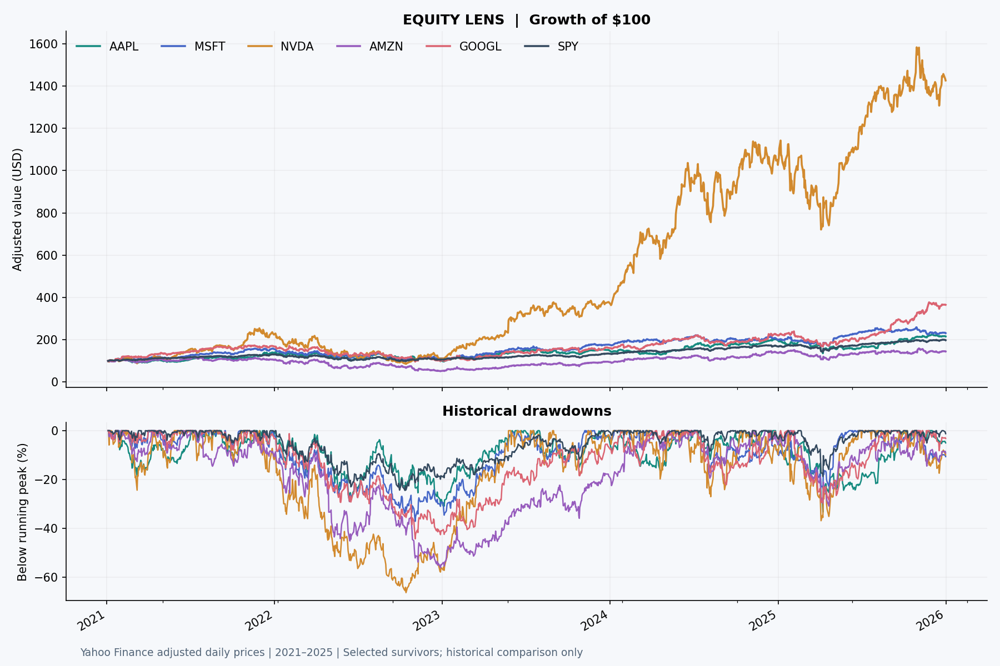

# Equity Lens — Equity Performance & Risk Analytics

[](https://github.com/Rhlbhskr/Stock-Price-Predictor/actions/workflows/checks.yml)

A reproducible Python and SQL project comparing five technology stocks with SPY. An interactive Streamlit dashboard, an executed research notebook and an exportable findings report explain historical returns, downside risk and the limits of next-day prediction.

**Stack:** Python · Pandas · NumPy · SQLite · Plotly · Streamlit · scikit-learn



## Questions

1. Which selected stocks outperformed the benchmark during 2021–2025?
2. How much volatility and drawdown accompanied that performance?
3. Does a return-based regression model outperform a simple previous-close prediction?

## Findings from the bundled snapshot

The dataset contains **7,530 validated daily records** for AAPL, MSFT, NVDA, AMZN, GOOGL and SPY, with **1,255 common price observations** from 4 January 2021 through 31 December 2025.

- NVIDIA returned **1,326.2%** versus **98.1%** for SPY, with **52.2% annualized volatility** and a **−66.3% maximum drawdown**.
- Apple's four-fold held-out experiment produced price MAE of **$2.5405** for Ridge versus **$2.4834** for the previous-close baseline: **2.30% higher error**. The historical-mean baseline achieved **$2.4722**.
- High historical return came with severe declines, while a more complex model did not improve next-day predictions in the Apple experiment.

These are historical results for selected surviving companies, not evidence of future returns or a profitable trading strategy. See the [complete findings](reports/findings.md), [research notebook](notebooks/equity_analysis.ipynb) and [CV/interview guide](docs/cv_and_interview.md).

## Run locally

Python **3.11** is the tested version. After dependency installation, no API key, TensorFlow or internet access is needed for the bundled snapshot.

```powershell
git clone https://github.com/Rhlbhskr/Stock-Price-Predictor.git
cd Stock-Price-Predictor
python -m venv .venv
.\.venv\Scripts\python.exe -m pip install -r requirements-dev.txt
.\.venv\Scripts\python.exe -m streamlit run app.py
```

On macOS/Linux, replace `.\.venv\Scripts\python.exe` with `.venv/bin/python`.

The dashboard defaults to **Offline snapshot**. Change the equities, dates and risk-free assumption, then click **Update analysis**. Select **Yahoo Finance** to request historical data from the live provider; this requires network access and provider availability. Downloads are cached for one hour and do not replace the bundled snapshot.

The original commands `streamlit run Stocks.py` and `streamlit run Stockprice.py` forward to the supported app.

## Dashboard

| View | Analytical evidence |
| --- | --- |
| Performance & findings | Normalized growth, total return, CAGR, monthly compounded returns and computed findings |
| Risk & relationships | Drawdowns, volatility, return correlations, beta, historical VaR and expected shortfall |
| Model evaluation | Four chronological folds, two baselines, price/return errors, per-fold results and downloadable predictions |
| Data quality & SQL | Validation audit, coverage, provenance, executable SQLite query and source-data exports |

## Reproduce the evidence

```powershell
.\.venv\Scripts\python.exe -m pytest -q
.\.venv\Scripts\python.exe -m scripts.build_report
```

The offline report command regenerates findings, the figure, performance metrics, quality audit, SQL output, model scores, held-out predictions and fold boundaries in `reports/`. Tests cover hand-calculated returns/drawdowns, quality rules, SQL/Pandas agreement, snapshot integrity, date alignment, future-data perturbation and dashboard interactions.

To explore the notebook, optionally install JupyterLab into the environment and launch it from the project root:

```powershell
.\.venv\Scripts\python.exe -m pip install jupyterlab
.\.venv\Scripts\python.exe -m jupyterlab
```

Open `notebooks/equity_analysis.ipynb`. The [GitHub Actions workflow](https://github.com/Rhlbhskr/Stock-Price-Predictor/actions/workflows/checks.yml) runs tests and report generation on pushes and pull requests.

## Data source and quality contract

Data comes from [Yahoo Finance](https://finance.yahoo.com/) through [yfinance](https://ranaroussi.github.io/yfinance/reference/api/yfinance.download.html), using `auto_adjust=True` for OHLC prices. The fixed USD snapshot requests `2021-01-01` through the exclusive end `2026-01-01`.

[The provenance manifest](data/market_snapshot.json) records the retrieval timestamp, requested dates, library version, adjustment policy, row count, SHA-256 and source-load quality audit. The snapshot stays fixed until an explicit refresh. It is historical data, not a live quote feed.

The pipeline:

1. Enforces required columns and parses dates, symbols and numeric fields.
2. Removes invalid keys, non-finite fields, nonpositive prices, negative volume and inconsistent OHLC bars.
3. Removes duplicate date/symbol keys, keeping the final valid source occurrence.
4. Sorts records and reports validation counts. Rule counts can overlap.
5. Aligns comparisons to common observed sessions, reporting excluded dates and never forward-filling prices.

Coverage diagnostics do not independently establish exchange-calendar completeness: a session missing from every ticker requires a separate calendar check. Volume is provider-reported share volume, not dollar liquidity.

To fetch a separate dataset without replacing the versioned snapshot:

```powershell
.\.venv\Scripts\python.exe -m scripts.refresh_data --start 2021-01-01 --end 2026-01-01 --output data/local/research.csv
```

Omit `--output` only when intentionally refreshing the bundled snapshot. Regenerate reports and update README/CV figures afterward; provider revisions can change adjusted historical prices.

## Metric definitions

| Metric | Definition |
| --- | --- |
| Daily return | `close[t] / close[t-1] - 1` |
| Total return | `last close / first close - 1` |
| CAGR | `(last / first) ** (365.25 / elapsed calendar days) - 1` |
| Annual volatility | Sample daily-return standard deviation × `sqrt(252)` |
| Maximum drawdown | Minimum of `close / running peak - 1` inside the selected window |
| Sharpe ratio | Daily mean excess return over the equivalent constant daily risk-free rate, annualized and divided by annual volatility |
| Beta | Sample covariance with benchmark returns / sample benchmark-return variance |
| Historical 95% VaR | Negative fifth percentile of observed daily returns |
| Historical 95% expected shortfall | Negative mean return at or below that fifth percentile |
| Monthly return | Product of `(1 + daily return)` within the month, minus 1; boundary months can be partial |
| MAE improvement | `1 - model price MAE / previous-close price MAE`; positive means lower error |

Correlations use **daily returns**, not price levels. The SQL monthly query reports an arithmetic daily mean, distinguished from compounded monthly return. One basis point is 0.01 percentage point.

## Model evaluation

The experiment predicts each next-session **return**, then converts it to a price using the observed previous close.

- Features: 20 lagged returns, lagged 5/20-session means and lagged 20-session volatility.
- Initial training set: first 60% of complete feature rows; remaining rows form four consecutive test blocks.
- A fresh `StandardScaler` and `Ridge(alpha=10)` fit only each fold's earlier training data, following [scikit-learn guidance on preprocessing leakage](https://scikit-learn.org/stable/common_pitfalls.html#data-leakage).
- Baselines: previous close (zero return) and mean training return, recalculated at each fold boundary.
- The model stays fixed inside each test block; features update with observed previous-session returns. This evaluates **one-step predictions**, not a recursive multi-day forecast.
- Hyperparameters are fixed in advance. Further tuning against these results requires a fresh final test period.
- Price MAE/RMSE, return MAE and per-fold results are reported. Direction accuracy excludes flat predictions; the zero-return baseline shows N/A.

The original LSTM scripts are archived in [`legacy/`](legacy/README.md). They scaled the full series before splitting and could reuse a saved model across tickers. The original `stock_model.h5` is retained but never loaded because its training ticker, dates and scaler are unknown. The new dashboard presents no unsupported 60-day forecast.

## Repository structure

```text
app.py                         Interactive dashboard
src/data.py                    Validation, snapshot and provider loading
src/analytics.py               Metrics and computed findings
src/modeling.py                Expanding-window model experiment
src/sql_analysis.py            Executable SQLite analysis
src/reporting.py               Shared findings report
sql/analysis.sql               LAG / PARTITION BY / monthly aggregation
scripts/refresh_data.py        Explicit download with provenance
scripts/build_report.py        Offline report and figure generation
data/market_snapshot.csv       Fixed real historical observations
data/market_snapshot.json      Source, hash and quality manifest
notebooks/equity_analysis.ipynb Research narrative and executed results
reports/                       Reproducible findings and evidence
tests/                         Calculation, data, model and UI tests
docs/cv_and_interview.md        CV bullets and interview walkthrough
legacy/                        Original prototype preserved
```

## Scope and limitations

The universe has survivorship/selection bias, SPY is not a sector-matched benchmark, adjusted prices can be revised, and one period does not establish general predictive performance. Correlation is descriptive. No trades, costs, slippage, taxes or portfolio allocation are modeled. Historical VaR/ES are sample summaries, not guaranteed loss bounds.

Next research steps are a predeclared broader universe, sector benchmarks, exchange-calendar validation and a fresh later evaluation period. This is an educational analytics study, not investment advice.
